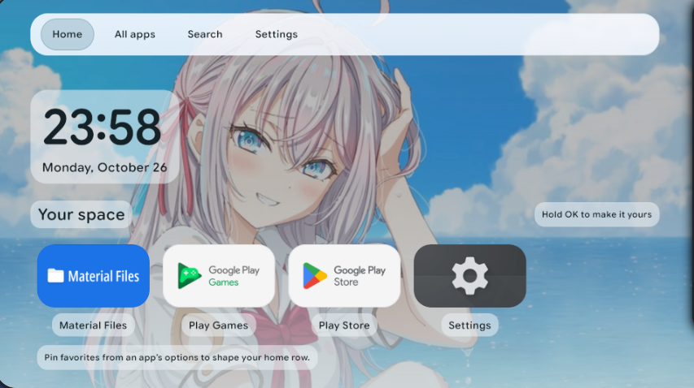
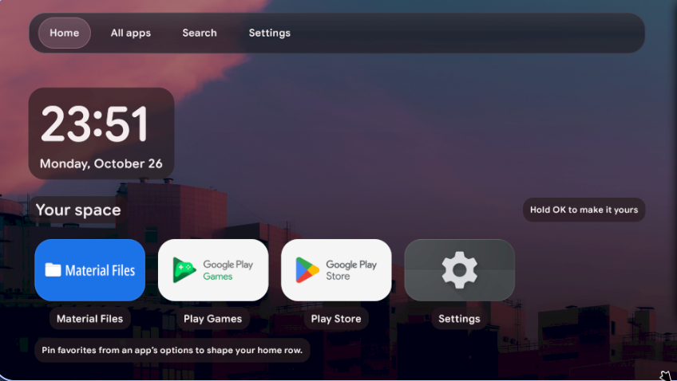
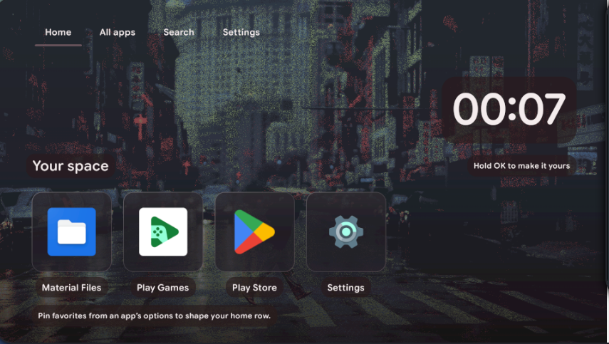
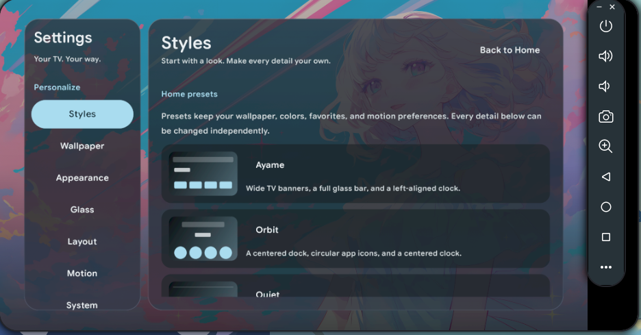
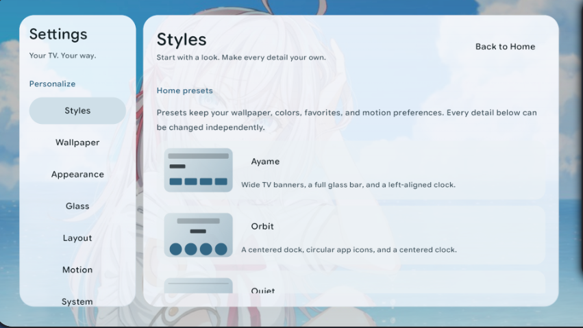
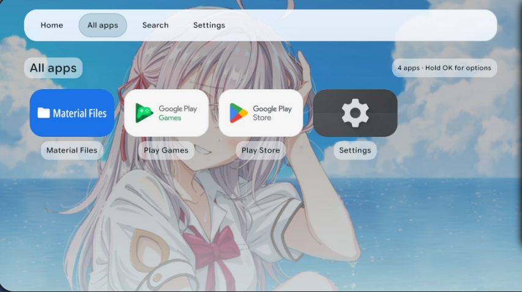
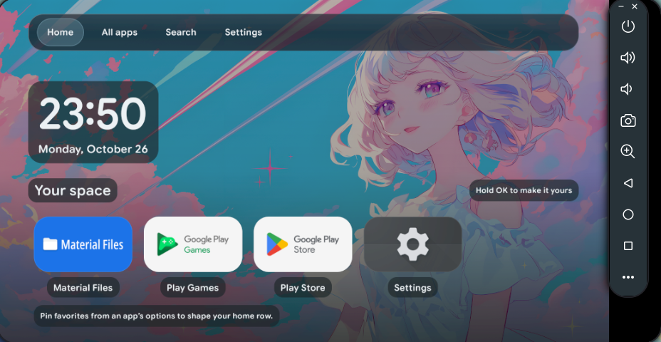
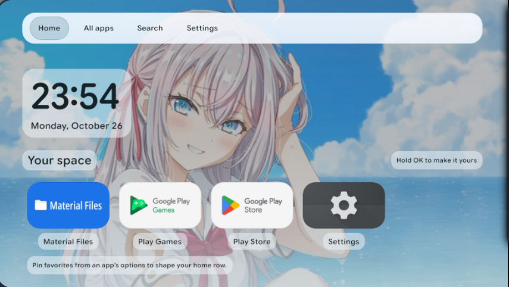
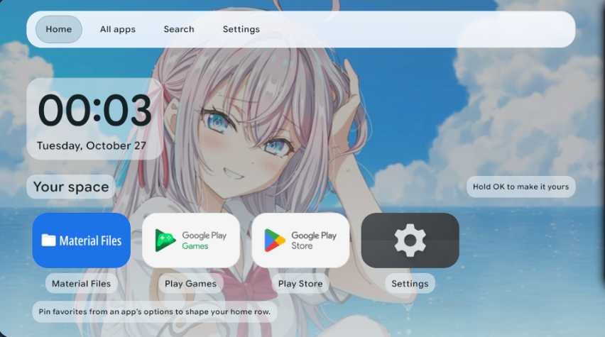

<h1 align="center">Ayame TV</h1>

<p align="center">Your TV. Your wallpaper. Your rules.</p>

<p align="center">
  
  
  
  
</p>

<p align="center">
  <a href="#showcase">Showcase</a> ·
  <a href="#highlights">Highlights</a> ·
  <a href="#make-it-yours">Make it yours</a> ·
  <a href="#install">Install</a> ·
  <a href="#build--try-the-emulator">Build & emulator</a>
</p>

A colorful, customizable launcher for Android TV and Google TV, inspired by
[Ayame Shell](https://github.com/andrija677/ayame-shell). Wallpaper colors flow
through the navigation, clock, app tiles, and settings. Pick a home style, pin
your apps, and give the artwork some room to breathe.

No ads, recommendations feed, account, or analytics. Just the things you put there.
The television has already heard enough sales pitches.

<p align="center">
  <a href="https://github.com/andrija677/ayame-tv/releases/latest"><b>Download the latest signed APK</b></a>
</p>

> [!NOTE]
> Ayame is still in early development. It is being tested in an Android TV
> emulator and on a Xiaomi TV Stick 4K, 2nd generation. Performance tuning and
> firmware-specific Home-button behavior are ongoing; compatibility with every
> TV is not yet established.

## Showcase



<p align="center"><sub><b>Home, with a view.</b> Wallpaper-derived colors, rounded surfaces, and your apps within reach.</sub></p>

<table>
  <tr>
    <td width="50%">
      
      <br><sub><b>Sunset palette</b> — the same home, with a warmer mood.</sub>
    </td>
    <td width="50%">
      
      <br><sub><b>Minimal navigation</b> — rounded icons and a clock on the right.</sub>
    </td>
  </tr>
  <tr>
    <td width="50%">
      
      <br><sub><b>Dark Settings</b> — a proper page for your rice, with a category rail.</sub>
    </td>
    <td width="50%">
      
      <br><sub><b>Light Settings</b> — same controls, different atmosphere.</sub>
    </td>
  </tr>
  <tr>
    <td width="50%">
      
      <br><sub><b>All Apps</b> — your installed apps, with the wallpaper still in view.</sub>
    </td>
    <td width="50%">
      
      <br><sub><b>Bring on the color.</b> The palette follows along.</sub>
    </td>
  </tr>
</table>

<details>
  <summary>Two more from the wallpaper testing department :3</summary>
  <br>
  
  <p><sub>23:54 — checking the wallpaper colors.</sub></p>
  
  <p><sub>00:03 — still checking. Very thorough research.</sub></p>
</details>

Screenshots are real emulator captures from development builds. Some include
the emulator toolbar; styling can vary slightly between releases.

## Highlights

| Your home | Personalization | Everyday use |
|---|---|---|
| Favorites row and searchable app grid | Automatic wallpaper colors or manual accents | D-pad and keyboard navigation |
| Native TV banners or fitted app icons | Four editable home presets | Pin, unpin, and reorder favorites |
| Full-page Settings with style previews | Light/dark, glass, frost, corners, and opacity | Manual updates from signed GitHub releases |
| Layout adapts to window size and text scaling | Clock position, icon size, labels, and columns | Import/export appearance as a JSON theme |
| Twelve bundled wallpapers available offline | Animation duration and optional gentle bounce | Optional inclusion of non-TV apps |

## Make it yours

Start with a preset, then change its parts independently. A preset keeps your
wallpaper, palette, favorites, app visibility, and motion preferences.

| Preset | Navigation | App tiles | Clock |
|---|---|---|---|
| **Ayame** | Full bar | TV banners | Left, with date |
| **Orbit** | Centered dock | Circle icons | Center, with date |
| **Quiet** | Minimal | Rounded icons | Right, without date |
| **Cinema** | Centered dock | TV banners | Hidden |

Mix top bars and tile shapes; adjust icon size, corners, tint, wallpaper dimming,
grid density, and clock placement. Glass, frost, animations, and bounce each have
their own switch. Slow the motion down, or turn it off entirely.

### Wallpaper colors

Pick an image in **Settings → Wallpaper → Wallpaper gallery**. Ayame extracts
its palette locally and updates the interface. Manual accent colors and hue
controls are available too. Palette-colored backings help keep text readable
over bright and detailed artwork.

The APK includes **twelve wallpapers**: My Dress-Up Darling, Roshidere, Bunny Girl
Senpai, and six colorful images from the author's collection. They work offline
on a fresh installation. No separate download or file manager is needed for
the built-in gallery.

Yes, the romance anime wallpapers are for testing. The colors. Obviously. >:3

You can import your own images using an Android document picker. Some TV
firmware needs a compatible file-manager app for that. Artwork and font credits
are in [third-party notices](THIRD_PARTY_NOTICES.md) and the
[wallpaper pack guide](docs/COLOR_TEST_WALLPAPERS.md).

### Share your rice

Use **Settings → System → Export theme** to save your appearance, layout, motion,
and favorite order. Import the JSON on another installation to apply it there.
Wallpapers are separate from the theme file. Automatic-color themes follow the
receiving device's wallpaper; disable automatic colors before export to keep
a particular accent.

## Install

1. Download `ayame-tv-VERSION.apk` from [Releases](https://github.com/andrija677/ayame-tv/releases/latest).
2. Copy the APK to your TV and open it with a file manager, or install it over ADB.
3. Allow that install source when Android asks, then open Ayame from your apps.
4. In **Ayame Settings → System → Use Ayame as Home**, choose Ayame where supported.

To sideload onto a TV already connected through ADB, replace the serial and APK
filename with your own:

```bash
adb devices
adb -s YOUR_TV_SERIAL install --no-streaming -r ayame-tv-VERSION.apk
adb -s YOUR_TV_SERIAL shell am start -n dev.andrija.ayametv/.MainActivity
```

TV firmware can hide the Home picker, intercept the remote, or reset the default
launcher. See [Home setup and device checks](docs/DEVICE_TESTING.md#default-home-on-a-tv)
for the reversible ADB helper. Ayame's setup leaves stock launcher packages enabled.

### Updates

Open **Settings → System → Check for updates**. A newer stable release offers
**Download & install**; Android asks you to confirm. APK downloads are checked
against release metadata, package name, version, and signing key.

There are no background update checks. Network requests happen when you choose
to check or download an update; wallpaper processing and preferences stay local.

> [!IMPORTANT]
> Development builds marked `-dev` use a different signing key from public APKs.
> To switch, export your theme and keep original wallpaper files, uninstall the
> development build once, and install an official release. Uninstalling removes
> app-owned data. Later official updates using the same key install in place.

## Everyday controls

| Control | Action |
|---|---|
| D-pad / arrow keys | Move between navigation, apps, and settings |
| OK / Enter | Select or launch |
| Hold OK / Menu on an app | App options, pinning, and favorite ordering |
| Up from the top app row | Return to navigation |
| Right from a Settings category | Enter its controls |
| Left from a Settings control | Return to the category rail |
| Back / Escape | Close the current page, menu, or search |
| Home | Reset to Home when firmware routes the button to Ayame |

## Build & try the emulator

Built with **Kotlin and Jetpack Compose**, targeting Android TV / Google TV on
Android 8.0 (API 26) or newer. The UI uses local AndroidX Palette extraction,
rounded Google Sans Flex typography, and a shared wallpaper frost texture.

On Arch / EndeavourOS, from the cloned project:

```bash
bash scripts/setup-android.sh
bash scripts/run-tv-emulator.sh
```

Setup downloads JDK 17, Android SDK 35, and Gradle into project-local `.tooling/`,
asks you to review SDK licenses, then builds, tests, and lints. It needs no sudo
or AUR. The emulator needs KVM, a graphical desktop with XWayland, and several GB
of free disk space.

To reopen the emulator while keeping its installed APK:

```bash
bash scripts/run-tv-emulator.sh --boot-only
```

Subsequent development builds:

```bash
./gradlew :app:assembleDebug :app:testDebugUnitTest :app:lintDebug
```

The debug APK is at `app/build/outputs/apk/debug/app-debug.apk`. You can also open
the project in Android Studio with JDK 17 and the required SDK packages installed.
The source-only `gradlew` script bootstraps a pinned, checksum-verified Gradle
distribution. CI builds debug artifacts; tagged releases build signed APKs.

See [development notes](docs/DEVELOPMENT.md), [architecture](docs/ARCHITECTURE.md),
[device testing](docs/DEVICE_TESTING.md), and [release signing](docs/RELEASING.md)
for the details.

## Contributing

Bug reports are welcome. Include the TV model, Android/firmware version, Ayame
version, reproduction steps, and a screenshot or logs when useful. A good-looking
launcher also needs to work from the sofa: test with a D-pad, larger text, and
modest hardware.

Performance on the Stick, Home-button behavior across firmware versions, and
broader device testing are active work. Emulator screenshots show the design;
they do not promise a particular frame rate on your TV.

## Credits & license

Made by [andrija677](https://github.com/andrija677), with the visual direction of
[Ayame Shell](https://github.com/andrija677/ayame-shell) and settings inspiration
from Lucid Shell.

Source code is [MIT licensed](LICENSE). Bundled font and wallpaper artwork have
their own notices and are excluded from that code license; see
[THIRD_PARTY_NOTICES.md](THIRD_PARTY_NOTICES.md).
